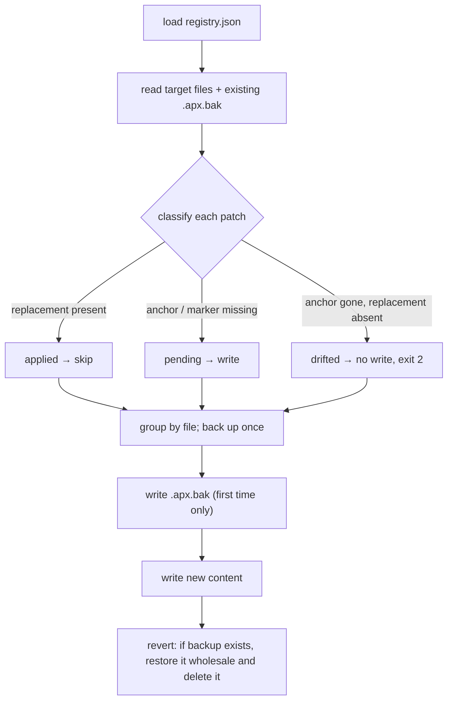

<p align="center">
  
</p>

<h1 align="center">🩹 GPT-purge · a patch queue for Codex &amp; ChatGPT configs</h1>

<p align="center"><strong>Version 1.0.0</strong></p>

<p align="center">
  <em>Give <code>AGENTS.md</code>, <code>~/.codex/config.toml</code> and ChatGPT custom instructions a real patch registry: apply by ID, inspect by ID, revert by ID — and get told loudly when upstream text has drifted.</em>
</p>

<p align="center">
  <a href="https://github.com/2968672902-cell/GPT-purge/stargazers"></a>
  <a href="https://github.com/2968672902-cell/GPT-purge/blob/main/LICENSE"></a>
  <a href="https://github.com/2968672902-cell/GPT-purge"></a>
  <br>
  
  
  
</p>

<p align="center">
  <a href="README.md">English</a> | <a href="README.zh-CN.md">中文</a>
</p>

## Contents

- [What it is](#what-it-is)
- [What it does not do](#what-it-does-not-do)
- [Scope](#scope)
- [Install](#install)
- [Usage](#usage)
- [Bundled patches](#bundled-patches)
- [Patch format](#patch-format)
- [How it works](#how-it-works)
- [Revert](#revert)
- [Exit codes](#exit-codes)
- [FAQ](#faq)
- [Relationship to dsh-purge](#relationship-to-dsh-purge)
- [License](#license)

---

## What it is

**GPT-purge** is a small local CLI that manages three kinds of "configuration-shaped prompts":

| File | Read by | Today's problem |
|---|---|---|
| `AGENTS.md` | Codex CLI, loaded per repo | hand-written, grows forever, no versioning |
| `~/.codex/config.toml` | Codex CLI approval / sandbox / network / model settings | edited once, forgotten |
| ChatGPT custom instructions / GPT instructions | web ChatGPT, custom GPTs | 1500 / 8000 character caps, no history |

They all share one flaw: **there is no patch mechanism**. Rolling the same `AGENTS.md` conventions out to ten repos means copying by hand or writing sed. And when the upstream template changes, you cannot tell whether your copy is stale, edited, or no longer matching.

GPT-purge turns that into a patch queue:

- Every change has a **stable id** (`AGENTS_HOUSE_RULES`, `CODEX_SANDBOX_MODE`, …) — not "another appended paragraph".
- Three patch kinds map to the three real insertion points: **marked block**, **TOML key**, **anchored replacement**.
- Explicit state machine: `applied` / `pending` / `drifted` / `skipped`.
- First write to a file is backed up to `<file>.apx.bak`; `revert` restores it byte for byte.
- When upstream text no longer matches, the patch reports **`drifted` and refuses to write** (exit code 2) instead of producing a half-broken file.

In one line: a tiny package manager for config files.

## What it does not do

This needs saying up front, because the name invites the wrong assumption:

**"Purge" here means purging config drift, hand-edit contamination and one-off changes — not purging safety limits.**

- It injects or replaces no persona prompt.
- It does not relax `approval_policy` / `sandbox_mode`. The bundled examples do the opposite: `on-request`, `workspace-write`, network off.
- It does not touch the network. Every operation happens inside the `--root` and `--config` you pass.
- It reads no conversations, touches no keychain, sends no telemetry.

Want your agent to ask fewer questions? That is your call — one line in `config.toml`. The value here is making "what did I change" **inspectable, revertible, reproducible**.

---

## Scope

- **Node.js ≥ 20** (built-in `node --test`, `node:fs`; zero dependencies).
- **Codex**: `AGENTS.md` at repo level, `~/.codex/config.toml` (`approval_policy`, `sandbox_mode`, `[sandbox_workspace_write]`, …).
- **ChatGPT**: character budget checks for custom instructions (1500) and GPT instructions (8000); writes `chatgpt/instructions.md` for you to paste, since the web UI exposes no file hook.
- **Windows / macOS / Linux**, with explicit `--root` / `--config`.

Mismatched patches show `drifted` or `skipped` and **never rewrite files blindly**.

---

## Install

Zero dependencies — clone and run.

### Quick start

```sh
git clone https://github.com/2968672902-cell/GPT-purge.git
cd GPT-purge
node bin/gpt-purge.mjs status --root /path/to/your/repo
```

Optional, to get a command on PATH:

```sh
npm link          # then: gpt-purge status --root .
```

### Step by step

**1. Pick a registry.** Use the bundled `patches/registry.json` or copy it and edit the bodies — keep ids stable, since status and revert match on them.

**2. Look before you leap.**

```sh
node bin/gpt-purge.mjs status --root . --registry patches/registry.json
node bin/gpt-purge.mjs apply  --root . --registry patches/registry.json --dry
```

`--dry` lists every file and block it would write, and writes nothing.

**3. Apply.** Drop `--dry`. Each file is backed up to `<file>.apx.bak` before its **first** modification. Re-running is idempotent: everything reports `unchanged`.

**4. Verify.** `status` again — everything `applied`, exit code 0.

### Hand it to an AI assistant

<details>
<summary><strong>Prompt for an AI agent (read-only check + dry run)</strong></summary>

<!-- AI-AGENT-START -->

Inside the user's clone of GPT-purge, inspect only — do not write:

1. `node bin/gpt-purge.mjs status --root <dir the user names> --registry patches/registry.json`
2. `node bin/gpt-purge.mjs apply --root <dir> --registry patches/registry.json --dry`
3. List every `drifted` patch id and explain which anchor text no longer matches. Do not edit the user's `AGENTS.md` / `config.toml` unless they explicitly ask. If they then ask to apply for real, drop `--dry`; on failure, show the raw output instead of claiming success.

<!-- AI-AGENT-END -->

</details>

---

## Usage

```sh
# state: applied / pending / drifted / skipped
node bin/gpt-purge.mjs status --root . [--json]

# apply (idempotent; --dry previews)
node bin/gpt-purge.mjs apply  --root . [--dry]

# revert: prefers byte-exact restore from .apx.bak
node bin/gpt-purge.mjs revert --root . [--dry]

# ChatGPT character budget (exit 2 when over)
node bin/gpt-purge.mjs budget chatgpt/instructions.md --kind chatgpt-custom
```

| Flag | Meaning |
|---|---|
| `--root <dir>` | project root, where `AGENTS.md` lives (default: cwd) |
| `--config <dir>` | Codex config dir, default `~/.codex` |
| `--registry <file>` | patch registry; defaults to `<root>/patches/registry.json` when the project has one, otherwise the registry bundled with the tool |
| `--dry` | preview only, nothing written |
| `--json` | machine-readable output (for CI) |
| `--chatgpt <bool>` | whether to process the ChatGPT target, default `true` |
| `--kind` | for `budget`: `chatgpt-custom` / `chatgpt-gpt` / `codex-agents` |

Real output:

```
$ node bin/gpt-purge.mjs apply --root . --config ./.codex
✓ AGENTS_HOUSE_RULES           applied   AGENTS.md
✓ AGENTS_REVIEW_CHECKLIST      applied   AGENTS.md
✓ CODEX_APPROVAL_POLICY        applied   .codex/config.toml
✓ CODEX_SANDBOX_MODE           applied   .codex/config.toml
✓ CODEX_NETWORK_OFF            applied   .codex/config.toml
✓ CHATGPT_HOUSE_RULES          applied   chatgpt/instructions.md

$ node bin/gpt-purge.mjs revert --root . --config ./.codex
- AGENTS_HOUSE_RULES           reverted             AGENTS.md
- file                         restored-from-backup AGENTS.md
...
```

---

## Bundled patches

Six examples in `patches/registry.json`, all **restrictive** by design — usable as-is or as templates:

| id | kind | target | effect |
|---|---|---|---|
| `AGENTS_HOUSE_RULES` | insert-block | `AGENTS.md` | pin pnpm, run tests before and after every change |
| `AGENTS_REVIEW_CHECKLIST` | insert-block | `AGENTS.md` | four pre-commit checks, incl. "no silent failures" |
| `CODEX_APPROVAL_POLICY` | toml-key | `config.toml` | `approval_policy = "on-request"` |
| `CODEX_SANDBOX_MODE` | toml-key | `config.toml` | `sandbox_mode = "workspace-write"` |
| `CODEX_NETWORK_OFF` | toml-key | `config.toml` | `[sandbox_workspace_write] network_access = false` |
| `CHATGPT_HOUSE_RULES` | insert-block | `chatgpt/instructions.md` | answer in Chinese, conclusion first, no invented sources |

---

## Patch format

A patch is one item in `patches[]`. The `id` is unique and **must never change** — changing it means a new patch, and all recorded state is lost.

### 1. `insert-block` — idempotent marked block

```json
{
  "id": "AGENTS_HOUSE_RULES",
  "kind": "insert-block",
  "target": "codex",
  "file": "AGENTS.md",
  "body": "## Conventions\n\n- use pnpm"
}
```

Result:

```markdown
<!-- apx:AGENTS_HOUSE_RULES:begin -->
## Conventions

- use pnpm
<!-- apx:AGENTS_HOUSE_RULES:end -->
```

- Block exists → body replaced, everything outside untouched.
- No block → appended at end of file.
- Never duplicated by re-running.

### 2. `toml-key` — set one key, create the section if missing

```json
{
  "id": "CODEX_NETWORK_OFF",
  "kind": "toml-key",
  "target": "codex-config",
  "file": "config.toml",
  "section": "sandbox_workspace_write",
  "key": "network_access",
  "value": "false"
}
```

- `section: ""` → top-level key.
- Missing section → created, then the key is written (that is `pending`, not drift).
- Key exists with a different value → edited in place, preserving comments and ordering where possible.

### 3. `replace-once` — anchored replacement, refuses when the anchor is gone

```json
{
  "id": "CODEX_MODEL_PIN",
  "kind": "replace-once",
  "target": "codex-config",
  "file": "config.toml",
  "anchor": "model = \"gpt-5\"",
  "replacement": "model = \"gpt-5-codex\""
}
```

| Situation | State | Action |
|---|---|---|
| `replacement` already present | `applied` | skip (idempotent) |
| `anchor` present | `pending` | replace |
| neither present | **`drifted`** | **no write**, exit 2 |

`drifted` is the whole point: it turns "my patch no longer matches upstream" into a loud error instead of a corrupted file.

---

## How it works



Deliberate choices:

- **Grouped by file** — three patches on one `AGENTS.md` mean one backup and one write.
- **Backup-first revert** — `revert` does not reverse-engineer your edits, it restores the pre-patch byte image. So it also repairs files you hand-edited after applying.
- **Fail closed** — `drifted` writes nothing and waits for a human.

---

## Revert

- Every touched file is backed up once as `<file>.apx.bak`.
- `revert` with a backup → byte-exact restore, backup deleted; without → reverse-remove the marked block / undo the replacement.
- `--dry` on either command tells you what would happen without touching disk.
- Applying twice is idempotent.

---

## Exit codes

| Code | Meaning |
|---|---|
| `0` | clean (all applied / unchanged) |
| `1` | usage or IO error (missing registry, bad JSON, unwritable file) |
| `2` | drift detected, or `budget` exceeded |

In CI: `node bin/gpt-purge.mjs status --json || exit 1` blocks any PR where the template and the repo disagree.

---

## FAQ

**Why "purge"? Sounds like a jailbreak tool.**
It refers to purging config drift. Functionally it tightens and pins configuration and removes no restriction — see [What it does not do](#what-it-does-not-do).

**Can it manage Claude Code's `CLAUDE.md`?**
Yes. `insert-block` and `replace-once` work on any text file; add a registry entry with `"file": "CLAUDE.md"`.

**Why do I paste ChatGPT instructions by hand?**
The web UI has no writable config hook, so the tool generates `chatgpt/instructions.md` and checks the character budget; the final paste is yours.

**Can it damage my hand-written content?**
Outside marked blocks: nothing changes. TOML: only the named key. `replace-once`: refuses to write when the anchor is missing.

**How does a team share conventions?**
Publish `registry.json` (repo or npm package) and run `apply --registry <path>` everywhere; use `status --json` as a CI gate.

---

## Relationship to dsh-purge

The **patch registry, numbered state machine, backup/revert and drift detection** design was inspired by [HunYiSage/dsh-purge](https://github.com/HunYiSage/dsh-purge). Credit where due.

The two tools point in opposite directions:

| | dsh-purge | GPT-purge |
|---|---|---|
| Target | DeepSeek Harness `@deepseek-ai` packages | Codex / ChatGPT config & instruction files |
| Mechanism | source-anchored patches + prompt injection | marked blocks / TOML keys / anchored replacement |
| Effect on safety defaults | relaxes (approval gate, sandbox) | tightens (`on-request`, `workspace-write`, network off) |
| Activation | "Apply" in the plugin panel | `apply` on the CLI |

GPT-purge contains no code, prompts, or patch data from dsh-purge — only the idea that config deserves a patch queue.

---

## License

[MIT](./LICENSE).

> **Disclaimer:** this tool modifies only the files you point it at, on your own machine. It makes no network calls and keeps no telemetry. Use it on repositories and accounts you administer; you are responsible for the outcome. Provided "as is", without warranty of any kind.

## Thanks

- Patch-registry idea: [HunYiSage/dsh-purge](https://github.com/HunYiSage/dsh-purge)
- Test runner: Node.js built-in `node --test`
