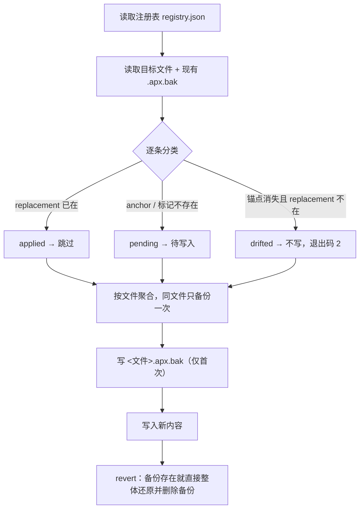

<p align="center">
  
</p>

<h1 align="center">🩹 GPT-purge · Codex / ChatGPT 配置补丁队列</h1>

<p align="center"><strong>Version 1.0.0</strong></p>

<p align="center">
  <em>给 AGENTS.md、~/.codex/config.toml 和 ChatGPT 自定义指令装上「补丁注册表」：按编号打、按编号查、按编号撤，改乱了会自己报漂移。Declarative, reversible config patches for Codex &amp; ChatGPT — patched by ID, drift-detecting, byte-exact rollback.</em>
</p>

<p align="center">
  <a href="https://github.com/2968672902-cell/GPT-purge/stargazers"></a>
  <a href="https://github.com/2968672902-cell/GPT-purge/blob/main/LICENSE"></a>
  <a href="https://github.com/2968672902-cell/GPT-purge"></a>
  <br>
  
  
  
</p>

<p align="center">
  <a href="README.md">English</a> | <a href="README.zh-CN.md">中文</a>
</p>

## 目录

- [介绍](#介绍)
- [它不做什么](#它不做什么)
- [适配范围](#适配范围)
- [安装](#安装)
- [使用](#使用)
- [内置补丁](#内置补丁)
- [补丁格式](#补丁格式)
- [工作原理](#工作原理)
- [还原](#还原)
- [退出码](#退出码)
- [常见问题](#常见问题)
- [与 dsh-purge 的关系](#与-dsh-purge-的关系)
- [许可证](#许可证)

---

## 介绍

**GPT-purge** 是一个跑在本机的命令行工具，管的是三类「配置型提示词」文件的增删改：

| 文件 | 谁在读它 | 现状 |
|---|---|---|
| `AGENTS.md` | Codex CLI 在每个仓库里自动加载 | 手写、越写越长、没有版本概念 |
| `~/.codex/config.toml` | Codex CLI 的审批、沙箱、网络、模型设置 | 手改一次就忘了改过什么 |
| ChatGPT 自定义指令 / GPT instructions | ChatGPT 网页端、自定义 GPT | 有 1500 / 8000 字符上限，贴进去就散了 |

这类文件的问题是同一个：**它们没有补丁机制**。你想统一团队里 10 个仓库的 `AGENTS.md` 约定，要么手抄十遍，要么写一段 sed；哪天上游模板变了，你也不知道自己那份是旧版、被改过、还是早就不匹配了。

GPT-purge 把这件事变成补丁队列：

- 每条改动有 **稳定的 id**（`AGENTS_HOUSE_RULES`、`CODEX_SANDBOX_MODE`…），不是「又追加了一段」。
- 三种补丁类型对应三种真实落点：**标记块插入**、**TOML 键写入**、**锚点替换**。
- 状态机明确：`applied` / `pending` / `drifted` / `skipped`。
- 首次改动前备份为 `<文件>.apx.bak`，`revert` 逐字节还原。
- 上游文本变了、锚点找不到时，**报 `drifted` 并拒绝写文件**，退出码 2——不会把文件改成一坨半成品。

一句话：它是配置文件的小型包管理器。

## 它不做什么

这件事必须先说清楚，因为它和名字给人的第一印象不同：

**GPT-purge 里的 purge，指的是清除配置漂移、手改污染和一次性改动，不是清除安全限制。**

- 不注入、不替换任何提示词 persona。
- 不改 `approval_policy` / `sandbox_mode` 这类安全默认值为「不拦」；内置示例恰恰相反，是把它们收敛到 `on-request` + `workspace-write` + 断开网络。
- 不联网。所有操作只发生在你 `--root` 指定的目录和 `--config` 指定的配置目录里。
- 不读你的对话、不碰你的钥匙串、不发遥测。

你想让 agent 少问你几句，那是你自己的选择，改 `config.toml` 一行就行；这个工具的价值在于让「你改了什么」这件事**可查、可撤、可复现**。

---

## 适配范围

- **Node.js ≥ 20**（用内置 `node --test` 和 `node:fs`，无第三方依赖）。
- **Codex**：`AGENTS.md`（仓库级）、`~/.codex/config.toml`（`approval_policy`、`sandbox_mode`、`[sandbox_workspace_write]` 等键）。
- **ChatGPT**：自定义指令（1500 字符）与 GPT instructions（8000 字符）的字符预算校验；写出 `chatgpt/instructions.md` 供你手贴，因为网页端没有文件钩子。
- **Windows / macOS / Linux** 均可，路径用 `--root` / `--config` 显式给。

对不上的补丁显示 `drifted` 或 `skipped`，**不会乱改文件**。

---

## 安装

零依赖，clone 下来就能跑。

### 快速开始

```sh
git clone https://github.com/2968672902-cell/GPT-purge.git
cd GPT-purge
node bin/gpt-purge.mjs status --root /path/to/your/repo
```

想直接当命令用（可选）：

```sh
npm link          # 之后可以直接 gpt-purge status --root .
# 或者一直用 node bin/gpt-purge.mjs，效果一样
```

### 分步说明

**第 1 步 —— 准备一个注册表。** 直接用仓库自带的 `patches/registry.json`，或复制一份改内容（id 保持稳定，状态和回滚都靠 id 匹配）。

**第 2 步 —— 看一眼会发生什么。** 先 `status`，再 `apply --dry`：

```sh
node bin/gpt-purge.mjs status --root . --registry patches/registry.json
node bin/gpt-purge.mjs apply  --root . --registry patches/registry.json --dry
```

`--dry` 会把要写的文件、要加的块全列出来，但一个字节都不落盘。

**第 3 步 —— 真打。** 去掉 `--dry`。每个文件在**第一次**被修改前会写成 `<文件>.apx.bak`；重复执行是幂等的，第二次全部 `unchanged`。

**第 4 步 —— 验证。** 再跑一次 `status`，应当全是 `applied`，退出码 0。

### 交给 AI 助手执行

<details>
<summary><strong>给 AI 助手（只读检查 + 干跑）</strong></summary>

<!-- AI-AGENT-START -->

在用户已 clone 的 GPT-purge 仓库目录内执行，只做检查，不要真的写入：

1. `node bin/gpt-purge.mjs status --root <用户指定目录> --registry patches/registry.json`
2. `node bin/gpt-purge.mjs apply --root <用户指定目录> --registry patches/registry.json --dry`
3. 把 `drifted` 的补丁 id 列出来，解释每个是因为锚点文本不匹配；不要自行修改用户仓库里的 `AGENTS.md` / `config.toml`，除非用户明确要求。

如果用户要真正应用，确认后去掉 `--dry` 即可；失败时保留输出原文，不要伪造成功。

<!-- AI-AGENT-END -->

</details>

---

## 使用

```sh
# 状态：applied / pending / drifted / skipped
node bin/gpt-purge.mjs status --root . [--json]

# 应用（幂等；--dry 只预览）
node bin/gpt-purge.mjs apply  --root . [--dry]

# 回滚：优先用 .apx.bak 逐字节还原
node bin/gpt-purge.mjs revert --root . [--dry]

# ChatGPT 字符预算检查（超限退出码 2）
node bin/gpt-purge.mjs budget chatgpt/instructions.md --kind chatgpt-custom
```

常用参数：

| 参数 | 作用 |
|---|---|
| `--root <dir>` | 项目根目录，`AGENTS.md` 从这儿找（默认当前目录） |
| `--config <dir>` | Codex 配置目录，默认 `~/.codex` |
| `--registry <file>` | 补丁注册表路径，默认 `<repo>/patches/registry.json` |
| `--dry` | 只预览，不写盘 |
| `--json` | 机器可读输出（给 CI 用） |
| `--chatgpt <bool>` | 是否处理 ChatGPT 目标，默认 `true` |
| `--kind` | `budget` 用：`chatgpt-custom` / `chatgpt-gpt` / `codex-agents` |

真实输出长这样：

```
$ node bin/gpt-purge.mjs apply --root . --config ./.codex
✓ AGENTS_HOUSE_RULES           applied   AGENTS.md
✓ AGENTS_REVIEW_CHECKLIST      applied   AGENTS.md
✓ CODEX_APPROVAL_POLICY        applied   .codex/config.toml
✓ CODEX_SANDBOX_MODE           applied   .codex/config.toml
✓ CODEX_NETWORK_OFF            applied   .codex/config.toml
✓ CHATGPT_HOUSE_RULES          applied   chatgpt/instructions.md

$ node bin/gpt-purge.mjs revert --root . --config ./.codex
- AGENTS_HOUSE_RULES           reverted             AGENTS.md
- file                         restored-from-backup AGENTS.md
...
```

---

## 内置补丁

`patches/registry.json` 里 6 条示例，全部是**收敛**方向的配置，可以直接用，也可以当模板抄：

| id | 类型 | 落点 | 效果 |
|---|---|---|---|
| `AGENTS_HOUSE_RULES` | insert-block | `AGENTS.md` | 团队约定：包管理器固定 pnpm、改前改后各跑一次测试 |
| `AGENTS_REVIEW_CHECKLIST` | insert-block | `AGENTS.md` | 提交前自查四项，含「不要引入静默失败」 |
| `CODEX_APPROVAL_POLICY` | toml-key | `config.toml` | `approval_policy = "on-request"` |
| `CODEX_SANDBOX_MODE` | toml-key | `config.toml` | `sandbox_mode = "workspace-write"` |
| `CODEX_NETWORK_OFF` | toml-key | `config.toml` | `[sandbox_workspace_write] network_access = false` |
| `CHATGPT_HOUSE_RULES` | insert-block | `chatgpt/instructions.md` | 回答用中文、先给结论、取舍列代价、不编出处 |

---

## 补丁格式

一个补丁就是注册表 `patches[]` 里的一项，`id` 唯一且**永远别改**（改了等于新补丁，旧状态全部丢失）。

### 1. `insert-block` —— 标记块，幂等

```json
{
  "id": "AGENTS_HOUSE_RULES",
  "kind": "insert-block",
  "target": "codex",
  "file": "AGENTS.md",
  "body": "## 项目约定\n\n- 包管理器固定为 pnpm"
}
```

写入结果是这段（`body` 原样保留，包括里面的空行和缩进）：

```markdown
<!-- apx:AGENTS_HOUSE_RULES:begin -->
## 项目约定

- 包管理器固定为 pnpm
<!-- apx:AGENTS_HOUSE_RULES:end -->
```

- 已有标记块 → 替换块内内容，块外一个字不动。
- 没有标记块 → 追加到文件末尾。
- 重复执行不会叠出第二份。

### 2. `toml-key` —— 改一个键，section 不存在就建

```json
{
  "id": "CODEX_NETWORK_OFF",
  "kind": "toml-key",
  "target": "codex-config",
  "file": "config.toml",
  "section": "sandbox_workspace_write",
  "key": "network_access",
  "value": "false"
}
```

- `section` 为空字符串 → 顶层键（如 `approval_policy`）。
- section 缺失 → **创建** section 再写键（这是 `pending`，不是漂移）。
- 键已存在且值不同 → 就地改值，注释和顺序尽量保留。

### 3. `replace-once` —— 锚点替换，锚点没了就罢工

```json
{
  "id": "CODEX_MODEL_PIN",
  "kind": "replace-once",
  "target": "codex-config",
  "file": "config.toml",
  "anchor": "model = \"gpt-5\"",
  "replacement": "model = \"gpt-5-codex\""
}
```

三态判定：

| 情况 | 状态 | 动作 |
|---|---|---|
| `replacement` 已在文件里 | `applied` | 跳过（幂等） |
| `anchor` 还在 | `pending` | 替换 |
| 两者都不在 | **`drifted`** | **不写文件**，退出码 2 |

`drifted` 是这个工具的立身之本：它把「我的补丁已经对不上上游了」变成一条显式报错，而不是悄悄写坏文件。

---

## 工作原理



设计上有几处刻意的选择：

- **按文件聚合**：同一个 `AGENTS.md` 上有 3 条补丁时，只备份一次、只写一次盘。
- **备份优先回滚**：`revert` 不逆向倒推，直接拿 `.apx.bak` 覆盖回去。所以即使你 apply 之后手工又改过文件，也能回到污染前的状态。
- **失败即停**：`drifted` 不写任何文件，等你人工确认。

---

## 还原

- 每个被修改的文件在**首次**修改前备份为 `<文件名>.apx.bak`。
- `revert` 有备份 → 逐字节还原并删除备份；没有备份 → 反向移除标记块 / 还原替换。
- `apply --dry` 和 `revert --dry` 都会告诉你将发生什么，但不动文件。
- 重复 apply 是幂等的。

---

## 退出码

| 码 | 含义 |
|---|---|
| `0` | 干净（全部 applied / unchanged） |
| `1` | 用法错误或 IO 错误（注册表不存在、JSON 坏了、文件不可写） |
| `2` | 检测到漂移，或 `budget` 超限 |

CI 里直接 `node bin/gpt-purge.mjs status --json || exit 1` 就能拦住「模板和仓库对不上」的 PR。

---

## 常见问题

**Q：为什么叫 purge？名字像越狱工具。**
名字来自它做的事——清除配置漂移。功能上它是收紧和固化配置，不解除任何限制；见[它不做什么](#它不做什么)。

**Q：能管 Claude Code 的 `CLAUDE.md` 吗？**
能。`insert-block` 和 `replace-once` 对任何文本文件都成立，`target` 用 `codex`（走 `--root`）或自定义注册表加一条 `file: "CLAUDE.md"` 即可。

**Q：ChatGPT 那边为什么要手动贴？**
网页端没有可写的配置文件钩子，所以工具只负责生成 `chatgpt/instructions.md` 并检查字符预算，最后一步必须你复制粘贴。

**Q：会不会改坏我手写的内容？**
标记块外的内容不动；TOML 只改指定键；`replace-once` 锚点对不上就拒绝写。

**Q：团队怎么统一？**
把 `registry.json` 放进共享仓库或 npm 包，各仓库 `apply --registry <路径>` 即可；`status --json` 在 CI 里做门禁。

---

## 与 dsh-purge 的关系

本项目的**补丁注册表、编号状态机、备份回滚、漂移检测**这套设计思路，受 [HunYiSage/dsh-purge](https://github.com/HunYiSage/dsh-purge) 启发，特此致谢。

两者的定位相反，这里说明白以免误解：

| | dsh-purge | GPT-purge |
|---|---|---|
| 作用对象 | DeepSeek Harness 的 `@deepseek-ai` 包 | Codex / ChatGPT 的配置与说明文件 |
| 主要手段 | 源码锚点补丁 + 提示词注入 | 标记块 / TOML 键 / 锚点替换 |
| 对安全默认值 | 放宽（审批门、沙箱） | 收紧（`on-request`、`workspace-write`、断网） |
| 何时生效 | 插件面板点「应用」 | 命令行 `apply` |

GPT-purge 不包含 dsh-purge 的任何代码、提示词或补丁数据，只是把「配置也该有补丁队列」这个想法做成了通用工具。

---

## 许可证

[MIT](./LICENSE)。随便用、随便改，保留版权声明即可。

> **免责声明：** 本项目只修改你本机上由你指定的文件，不联网、不上传、不留遥测。请只在你拥有管理权限的仓库与账号上使用；由使用者自行承担使用后果。按「现状」提供，不作任何明示或暗示担保。

## 致谢

- 补丁注册表思路：[HunYiSage/dsh-purge](https://github.com/HunYiSage/dsh-purge)
- 测试框架：Node.js 内置 `node --test`
